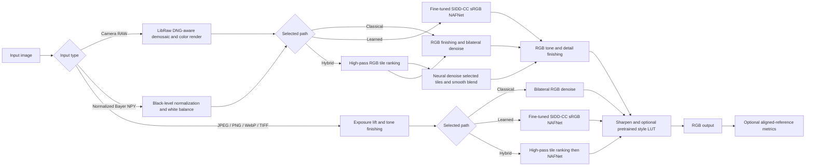

# MOD-ISP workbench

A local experimental Bayer-to-RGB workbench based on the MOD-ISP proposal. The application contains classical demosaicing, a compact trainable Haar-wavelet attention network and pointwise learned color transform, variance-gated tile processing, reference metrics, paired-data training, distillation, LiteRT INT8 export, and held-out evaluation. This is an experimental implementation; it has not met the blueprint’s projected quality targets.

The [Vercel project](VERCEL.md) serves a static project page. Image inference runs locally or in Docker because the model runtime and comparison payload exceed Vercel Function limits.

## Installation and launch

Use Python 3.10–3.12. For a local inference/demo run, install the runtime dependencies and launch with one command:

```sh
./run_local.sh
```

It creates `.venv` if needed, installs `requirements-runtime.txt`, and starts the app at http://127.0.0.1:5050. For training, evaluation, distillation, and LiteRT export, install the full research dependencies instead:

```sh
python3 -m venv .venv
source .venv/bin/activate
pip install -r requirements.txt
python app.py
```

Open http://127.0.0.1:5050. The server binds to the local machine. Uploads are limited to 30 MB. RGB images above 16 megapixels are resized proportionally to fit the processing limit; RAW and NPY Bayer inputs above 16 megapixels are rejected to preserve sensor mosaic handling. RAW support uses LibRaw via `rawpy`; 2×2 Bayer patterns are normalized to RGGB after black-level subtraction and camera white balance. Unsupported sensor mosaics fail explicitly. `.npy` input is a 2-D float array of normalized RGGB Bayer values in [0, 1]. JPEG/PNG/WebP/TIFF remain rendered RGB and use RGB-domain exposure, tone mapping, and the fine-tuned sRGB denoiser. They are never mosaiced or sent to the Bayer model. The Bayer pipeline runs only for camera RAW and normalized RGGB NPY inputs. Odd Bayer dimensions are cropped to even values.

### One-command container run

Docker provides a CPU inference/demo image. Build and run it from this directory:

```sh
docker build -t mod-isp .
docker run --rm -p 127.0.0.1:5050:5050 mod-isp
```

Then open http://127.0.0.1:5050. The port is published on loopback by default. The image includes the local inference checkpoints and a pinned, license-preserved copy of Samsung's NAFNet architecture, but excludes datasets and teacher weights. Training, evaluation, and LiteRT conversion use the full host requirements and scripts below. The Docker image has not been built in this workspace because Docker is not installed; see `CONTAINER_NOTICE.md` for its scope and the upstream license notice.

## Project documents and evaluation

- [System architecture diagram](docs/architecture.md)
- [Model and implementation design](docs/model-design.md)
- [Ablation study](docs/ablation-study.md)
- [Failure-case analysis](docs/failure-case-analysis.md)
- [Comparative evaluation report](eval_probID_TeamID.md) — replace the filename placeholders with the assigned contest/problem and team IDs.
- [Visual design system](DESIGN.md)

The local datasets and original MetaISP teacher checkpoint are not included. Evaluation JSONs retain measured metrics with workspace-specific absolute paths normalized.

## Implemented architecture

This diagram describes the current code paths. It does not describe unimplemented blueprint targets such as a camera-calibrated CCM, a learned noise estimator, or mobile NPU execution.



Camera RAW files are demosaiced and color-rendered through LibRaw, which applies embedded DNG camera metadata. The available SIDD-CC sRGB denoiser then operates on that rendered image; the Bayer-trained checkpoint is not applied to cameras it was not calibrated on. Normalized Bayer NPY files still use the learned Bayer path. The Bayer gate uses relative tile ranking and routes 96% of tiles in the recorded held-out run. It is not a calibrated sensor-noise estimator. Bayer and sRGB learned models are separate checkpoints and were trained/evaluated on different data domains.

For RGB and camera-RAW three-path comparisons, the Learned output's sRGB tile predictions are reused to compose Hybrid, avoiding a duplicate forward pass on selected tiles. The UI marks Hybrid latency and Python allocation as **incremental comparison costs**, not standalone Hybrid latency or total end-to-end runtime; the Hybrid output itself still uses the same tile model, routing rule, and smooth blend. The reported HTTP request wall time is the complete time to produce and encode all three results.

When a camera RAW file is processed, the workbench also displays a RAW sensor record with the reported camera/CFA, black and white levels, as-shot white-balance gains, matrix-use status, LibRaw renderer, and observed sample fractions at the black/white boundaries. Black levels and gains are reported in the decoder's RGGB-normalized order; the CFA label records the source pattern. The clipping check is a simple fraction of decoded visible mosaic samples within one code value of the corresponding black or white level; the 1% note is a review threshold, not a camera clipping standard. Noise is explicitly marked as uncalibrated. RGB and NPY inputs do not show this camera-specific record. It is provenance and a sanity check, not a learned sensor-noise estimate or proof of RAW image quality.

## Data and training

Use separately collected and registered training, calibration and held-out test sets. Each has `input/` and `target/` directories. Pair files by matching stem: input can be camera RAW, normalized RGGB `.npy`, or an RGB image for Bayer-simulation training; target is RGB PNG/JPEG/TIFF with identical dimensions. RGB-to-Bayer mosaicing in the training utility is synthetic data augmentation only. It does not make an RGB image sensor RAW and must not be used for real-camera RAW evaluation. The live workbench keeps JPEG/PNG in RGB and sends them to the separate sRGB denoiser. RAW targets must already be geometrically aligned and color matched. Dataset access and licenses are the user's responsibility. Keep test data out of training and calibration.

```sh
python train.py --data data/train --epochs 10 --patch 128 --out models/mod_isp.pt
python train.py --data data/train --teacher models/teacher.pt --epochs 10 --out models/student.pt
python evaluate.py --data data/test --checkpoint models/mod_isp.pt --out evaluation.json
python export_litert.py --checkpoint models/mod_isp.pt --calibration-data data/calibration --out models/mod_isp_int8.tflite
```

Training is deterministic given the same software/hardware and `--seed` where supported. The teacher may be a compatible `bayer-v1` checkpoint, or a separately supplied TorchScript model selected with `--teacher-format torchscript`. A TorchScript teacher must accept packed RGGB NCHW tensors in [0,1] and return finite NCHW RGB tensors at twice the spatial resolution. Adapt camera metadata, packing, normalization, and output color space for the particular teacher before distilling; incompatible models are rejected when output shapes do not match. Only trusted teacher files should be loaded. The 2023 MetaISP adapter described below also supports its original pretrained teacher. The app loads `models/mod_isp.pt` when processing; the LiteRT export is a fixed-size tile model, and the sidecar report contains its quantization parameters and a comparison against PyTorch on a calibration tile. Export does not itself prove mobile NPU compatibility or performance; benchmark on the intended hardware and delegate.

Evaluation records per-image PSNR, SSIM, CIEDE2000 Delta E, LPIPS (where available), latency, parameters, file size and process peak RSS. LPIPS may download pretrained weights on first use; if unavailable it is reported as null. Memory is process high-water RSS, not isolated model memory. Workbench memory uses Python allocations and excludes native/accelerator allocations. Use held-out references and report hardware, dataset, alignment and measurement conditions with any result.

## Current limits

- The Bayer checkpoint was trained on a tiny, single-scene subset; do not report the blueprint's projected numbers as measured outcomes. The separate SIDD-CC sRGB model is a denoising adaptation, not a Bayer RAW-to-RGB model.
- The compact Bayer restoration model has its own learned color transform; its training is too small and camera-specific calibration is not established. Camera RAW output now goes through LibRaw's embedded DNG color rendering. The optional separate CNILUT is a pretrained creative style transform, not a camera color calibration. The gate is calibrated for PSNR on one scene, not a sensor-noise model. Sharpening is unsharp masking. There is no measured downstream object-detection improvement.
- The IJCAI 2024 MetaISP teacher weights, learned gating, adaptive sensor-aware noise calibration, mobile NPU timing and a broad multi-scene benchmark are not supplied. Full blueprint parity and target quality require those separate research and validation steps.
- The rendered-RGB human path estimates exposure from linearized luminance, applies a highlight shoulder while preserving RGB channel ratios, then uses conservative bilateral denoising and sharpening. The RGB hybrid path ranks tiles by robust high-pass residual and sends the noisiest half to the sRGB denoiser; this is an RGB routing heuristic, not the calibrated Bayer variance gate. The existing Bayer gate applies only to Bayer input. Mode and strength tune the exposure target and finishing. A camera-specific CCM cannot be recovered from an ordinary JPEG.

## Included small-scale run

The data are from [SIDD-CC](https://huggingface.co/datasets/MhdMohammadi/SIDD-CC), a re-processing of [SIDD](https://abdokamel.github.io/sidd/). The dataset card requests citation of both works and specifies SIDD terms of use. The training and calibration crops use scene `0001_001_S6_00100_00060_3200_L` (40 and 8 non-overlapping crops); four test crops use a different scene `0034_002_GP_00100_00160_3200_N`. Both source scenes are from the dataset's training split. This is a custom scene-separated smoke test, not the official SIDD-CC test benchmark. `prepare_sidd.py` uses the two downloaded pairs in `data/source/`, clips normalized values to [0,1], and aligns the Bayer pattern by cropping the same pixels from both input and target.

`models/mod_isp.pt` is the promoted student distilled from the authors’ 2023 MetaISP real_D teacher for 320 optimizer steps. `models/mod_isp_baseline.pt` retains the previous non-MetaISP student. On the four held-out patches, learned-path means were 12.10 dB PSNR, 0.404 SSIM, 28.93 Delta E and 0.725 LPIPS for the new student, versus 11.81 dB, 0.396, 29.09 and 0.728 respectively for the previous student. `student_metaisp2023_evaluation.json` contains per-image results; these four patches from one unseen scene do not establish generalization.

The promoted `models/mod_isp_int8.tflite` is a fixed-tile full-int8 export of the new student, calibrated with exposure-scaled training crops. `student_metaisp2023_litert_verification.json` compares eight tiles from the held-out scene with PyTorch: mean absolute output difference 0.0174 and zero input clipping in this small sample. This ran on CPU; neither mobile NPU compatibility nor mobile latency has been tested. A Nikon NEF file from the [rawpy test suite](https://github.com/letmaik/rawpy/tree/main/test) was decoded and normalized successfully.


## CNILUT and gate verification

The optional UI selector applies the original authors’ three-style CNILUT checkpoint, `models/nilutx3style.pt`, from [NILUT](https://github.com/mv-lab/nilut). The original code license is in `third_party/nilut/LICENSE`. This checkpoint has 134,147 parameters and is separate from the 29,980-parameter restoration model; it is not the blueprint's projected 8.7K-parameter transform and is not included in `mod_isp_int8.tflite`. The app samples it to a 33³ RGB LUT and uses trilinear interpolation, processing images in bounded chunks. `cnilut_verification.json` reports mean absolute approximation errors of 0.00186–0.00193 on random 8-bit colors, including 8-bit output quantization. Its three pretrained visual styles are off by default; they are not calibrated to the camera, and should not be interpreted as improving Delta E.

Regenerate the gate with `python calibrate_gate.py --data data/calibration --max-psnr-drop 0.5`. It ranks tiles by variance normalized by squared mean brightness and selects a fixed per-image routing budget that keeps calibration-set mean PSNR within 0.5 dB of all-neural hybrid routing. Its per-image rank adapts to exposure but is not a calibrated noise estimate; the quality budget is not guaranteed outside the calibration data. For the promoted student, the chosen gate routed 96% of tiles on each held-out patch and changed PSNR by -0.234 dB on average, with a worst individual change of -0.552 dB. Warm local CPU hybrid latency averaged 40.75 ms all-neural versus 40.40 ms gated (three repeats, 256×256 patches; includes model loading and classical finishing). These few measurements do not establish statistical significance, mobile speed, or actual MAC savings. `student_metaisp2023_gate_validation.json` contains per-image quality and timing results; `student_metaisp2023_evaluation.json` includes other image metrics.


## MetaISP teacher and mobile benchmark status

The blueprint references Chen et al.'s [IJCAI 2024 MetaISP](https://www.ijcai.org/proceedings/2024/0076.pdf). Its compatible public checkpoint was not located. At the user's request, the promoted student was instead distilled from the authors’ [2023 MetaISP](https://github.com/vccimaging/MetaISP), `MetaISPNet_real_D.pth` (6,257,501 parameters; SHA-256 `81c388245a0cbc5ff0b16c20da05068202f5ba54103544e1afb2db686eb8421a`). This is a different model and does not establish the blueprint’s claimed 2024 MetaISP results. The extracted inference code and upstream MIT license are under `third_party/metaisp2023/`; the CUDA-only optical-flow component is not used.

The adapter maps RGGB to the teacher's B/G/R/G channels, constructs a patch-local resized BGR context, supplies the SIDD AsShotNeutral white-balance values, coordinate maps and the target device style. The context is patch-local instead of the original full-frame context; this is an adaptation and must be revalidated per dataset. Training used the Samsung style and training-scene metadata; teacher evaluation used Pixel style and test-scene metadata. Do not reuse these camera values for unrelated images. The teacher averaged 17.63 dB PSNR on the four test patches (`teacher2023_evaluation.json`). Reproduce distillation with:

```sh
python train.py --data data/train --teacher models/metaisp_2023_real_D.pth --teacher-format metaisp2023 --teacher-neutral 0.55273438 1 0.484375 --teacher-device 1 --epochs 8 --patch 128 --out models/student_metaisp2023.pt
python calibrate_gate.py --data data/calibration --checkpoint models/student_metaisp2023.pt --out models/student_metaisp2023_gate.json
python verify_gate.py --data data/test --checkpoint models/student_metaisp2023.pt --gate models/student_metaisp2023_gate.json --out student_metaisp2023_gate_validation.json
```


No phone was available, and `adb` is not installed here. `benchmark_android.py` is a preparation script for an authorized Android device, a compatible `benchmark_model` binary, and a matching vendor NPU delegate. It records device properties, file hashes, CPU and delegate logs, and exit codes. Review operation profiling and delegate logs to confirm the NPU actually executed the model and identify CPU fallback; a successful command or delegate request alone is not proof. Refer to [Google's LiteRT delegate guidance](https://developers.google.com/edge/litert/performance/delegates) and vendor-specific instructions. The existing CPU LiteRT numbers are not mobile or NPU results. The standalone LiteRT model excludes both the variance gate and CNILUT, so its tile inference time is not end-to-end ISP latency.

## Additional model and dataset reference supplied by the user

The user also supplied the [SIDD project page](https://abdokamel.github.io/sidd/) and [SamsungLabs Modular Neural ISP](https://github.com/SamsungLabs/modular_neural_isp). SIDD is a dataset and benchmark resource rather than a pretrained model: its page describes SIDD-Small as 160 noisy/ground-truth pairs and SIDD-Medium as 320 pairs. The app's current experiment uses a small set of processed SIDD-CC Bayer/sRGB pairs, not the full SIDD raw-RGB benchmark. The official SIDD evaluation server is currently reported as down on the project page.

The Samsung repository was cloned for inspection at `../../work/modular_neural_isp` (upstream commit `5a845f6`). Its generic Lite NAFNet denoiser checkpoint (`denoising/models/generic_lite.pth`) loads with the included model definition and contains 245,223 parameters. It accepts 3-channel raw-RGB tensors and is a pre-demosaic raw-RGB denoising stage within Samsung's larger camera pipeline; it does not accept this app's packed 4-plane Bayer tiles or return the app's full Bayer-to-display-RGB output. Its expected model input also needs camera-pipeline normalization and stage metadata. Therefore, it was not used as the current student teacher and no misleading metric against the existing display-referred SIDD-CC target was produced. A compatible evaluation needs registered RAW-RGB input/ground truth in matching linear sensor space and the documented Bayer pattern, black level, white level and camera calibration.

The Samsung code and pretrained weights carry CC BY-NC 4.0 terms (`work/modular_neural_isp/LICENSE.md`); its README describes the code as an academic research implementation. The user-facing app does not bundle or enable those weights. Model interface smoke check: loaded the generic-lite checkpoint, matched all state-dict keys, and ran a 48×48 RGB tensor through it. Six denoising checkpoints are available in that local upstream clone, including `generic_lite`, `generic_base`, `generic_large`, and S24-specific variants. The generic-lite SHA-256 is `9f39f1f0fa83cfa25d3d1e1c2896cbdbb835f6a7f424042dfc93b217d2b9f980`. This inspection does not validate image quality, speed, or use on another domain.

To reproduce the sRGB denoising adaptation after downloading the SIDD-CC SRGB modality and benchmark blocks:

```sh
python train_sidd_srgb.py --dataset data/siddcc_srgb --samsung-repo ../../work/modular_neural_isp --init ../../work/modular_neural_isp/denoising/models/generic_lite.pth --epochs 10 --device auto
```

The script reserves 12 of the 115 training scenes for validation, trains on the other 103 scenes, selects the best validation epoch, and evaluates the original and adapted checkpoint on all 928 published sRGB test blocks. It creates `models/sidd_srgb_nafnet_lite.pt` and `models/sidd_srgb_nafnet_lite.json`. This is a fine-tuned sRGB-domain denoiser, not a RAW Bayer ISP model and not an official Samsung benchmark result. Dataset files remain subject to the SIDD terms of use.

The completed run used 206 pairs from 103 scenes for 10 epochs on Apple MPS (seed 2026); the best checkpoint was epoch 10. On the 24 validation pairs from 12 held-out training scenes, mean center-patch PSNR rose from 32.18 dB for the starting checkpoint to 35.93 dB. On the untouched 928-block test benchmark, mean block PSNR/SSIM were 26.12 dB/0.425 for noisy input, 29.30 dB/0.574 for the original Samsung generic-lite checkpoint, and 33.78 dB/0.776 for the fine-tuned checkpoint. `models/sidd_srgb_nafnet_lite.pt` is 1.17 MB with 245,223 parameters. The per-block results and training history are in `models/sidd_srgb_nafnet_lite.json`. These are means across benchmark blocks, not a claim of official leaderboard scoring. This sRGB model is kept separate from `models/mod_isp.pt`; the latter still expects Bayer input and returns RGB.

## Rendered-RGB workflow verification

The supplied 6000×4000 dark JPEG was processed through the live API after this input-path correction. It was resized to 4898×3264 (16 MP cap) and returned Classical, Learned, and Hybrid results in 28.6 seconds on the local Apple-MPS machine. The RGB hybrid routed 50% of its tiles through the SIDD-CC sRGB denoiser. The output is visibly brighter while maintaining the original channel balance. No matching clean reference was provided, so this is an end-to-end runtime and visual smoke check only; no quality metric is claimed for this photo. The returned comparison payload was 13.7 MB after JPEG encoding (rather than base64-encoded full-resolution PNGs).
