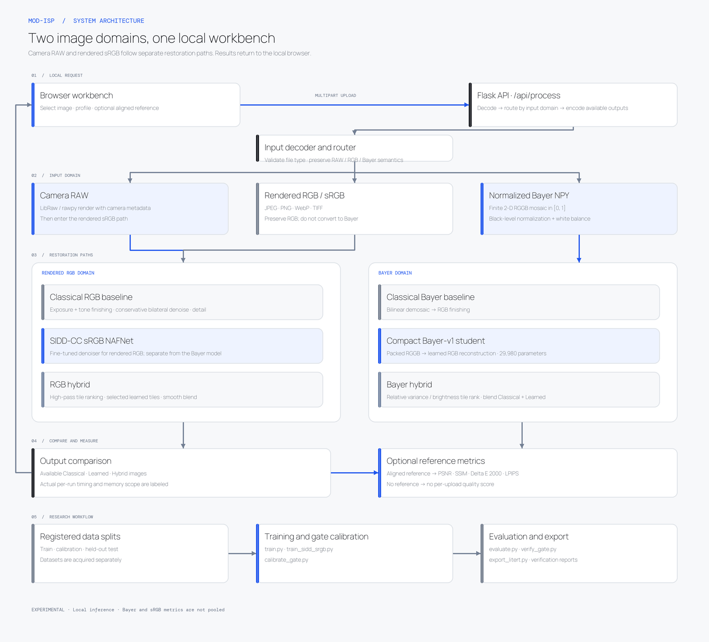

# System architecture

This diagram reflects the implemented code paths. The Bayer restoration model, sRGB denoiser, and camera-managed RAW renderer are separate paths; they are not interchangeable models.

## Runtime boundaries

- Uploads are processed by the local Flask app. The image API is not a hosted service.
- Camera RAW is rendered through LibRaw using camera metadata; the Bayer model is intentionally not applied to camera RAW without camera-specific paired validation.
- `.npy` Bayer input must be a finite normalized 2-D RGGB mosaic in `[0,1]`.
- Rendered RGB stays in an RGB denoising/finishing path and is never mosaiced for inference.
- When a matching, aligned reference is supplied, metrics compare each returned output to that reference. Without one, quality metrics are absent.
- The hybrid path is a tile-routing heuristic. Routed-tile percentage is not a measured MAC reduction; reported incremental timing is not standalone end-to-end latency.

## Source map

| Concern | Files |
|---|---|
| Web UI and API | `app.py`, `templates/index.html`, `static/` |
| Bayer decoding and classical ISP | `isp.py` |
| Compact Bayer model | `model.py` |
| Training / teacher distillation | `train.py`, `metaisp2023_adapter.py` |
| sRGB denoiser training | `train_sidd_srgb.py`, vendored NAFNet definition under `third_party/` |
| Evaluation / gate / export | `evaluate.py`, `calibrate_gate.py`, `verify_gate.py`, `export_litert.py` |
